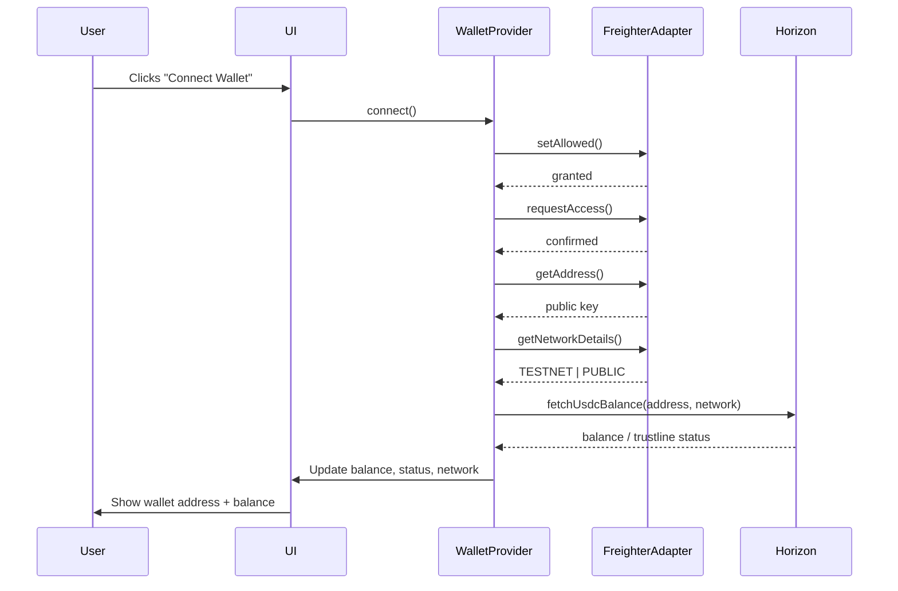
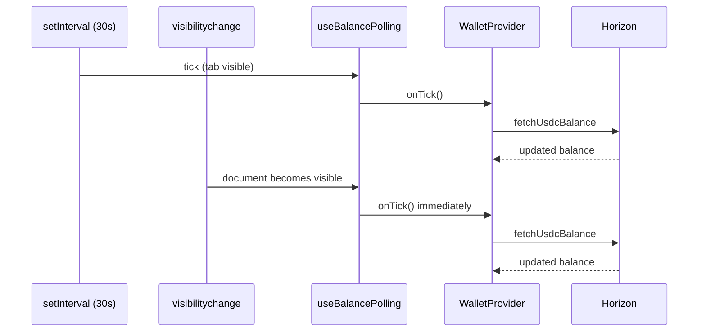

# Wallet Integration Guide

This document explains how wallet connection, balance fetching, and USDC trustline detection work in Disciplr.

## Module Map

```
src/context/
├── WalletContext.tsx        – Provider, reducer, public API (useWallet, WalletProvider)
├── freighterAdapter.ts      – FreighterAdapter interface + defaultFreighterAdapter
├── useBalancePolling.ts     – 30-second balance refresh hook (pauses when tab hidden)
└── useWalletWatcher.ts      – Fast poll for address/network changes (ACCOUNT_POLL_INTERVAL)
```

## Connection Flow



## Balance Polling Sequence



## Swapping the Adapter (testing)

Pass a `FreighterAdapter` fake to `WalletProvider` via the `adapter` prop:

```tsx
const fakeAdapter: FreighterAdapter = {
  isAllowed: async () => ({ isAllowed: true }),
  setAllowed: async () => {},
  requestAccess: async () => true,
  getAddress: async () => ({ address: 'GFAKE...', error: null }),
  getNetworkDetails: async () => ({ network: 'TESTNET' }),
};

render(
  <WalletProvider adapter={fakeAdapter}>
    <App />
  </WalletProvider>
);
```

## Public API (unchanged)

| Export | Description |
|---|---|
| `WalletProvider` | React provider — composes adapter + hooks |
| `useWallet` | Context hook |
| `walletReducer` | Pure state reducer |
| `BALANCE_REFRESH_INTERVAL` | 30 000 ms |
| `ACCOUNT_POLL_INTERVAL` | 2 000 ms |
| `CONNECT_TIMEOUT_MS` | Env-driven, clamped to [5 000, 120 000] ms |
| `WALLET_DISCONNECTED_KEY` | localStorage key |
| `WalletNetwork` | `'TESTNET' \| 'PUBLIC'` |
| `WalletStatus` | `'disconnected' \| 'restoring' \| 'connecting' \| 'connected' \| 'error'` |
| `BalanceStatus` | `'idle' \| 'loading' \| 'success' \| 'no_trustline' \| 'error'` |
